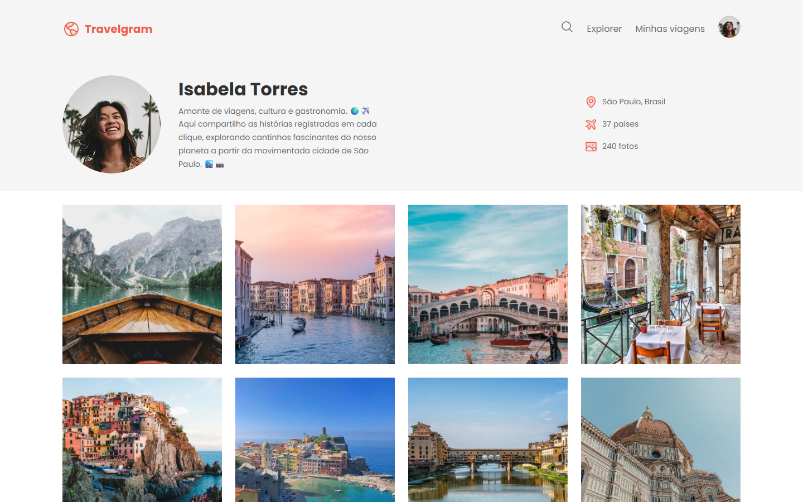

# ✈️ Travelgram

Página de perfil de viagens no estilo rede social, com cabeçalho de perfil, informações da viajante e galeria de fotos.

🔗 **Acesse o projeto:** [caioviananog.github.io/projeto-travelgram](https://caioviananog.github.io/projeto-travelgram/)



## 🛠️ Tecnologias

- HTML5
- CSS3

## ✨ Funcionalidades

- Cabeçalho com logo, busca e navegação
- Seção de perfil com foto, bio e estatísticas (cidade, quantidade de países e fotos)
- Galeria de fotos organizada em grid

## 📚 O que aprendi

- Estruturar uma página com HTML semântico
- Montar layouts com Flexbox e Grid
- Organizar arquivos do projeto (imagens, ícones e estilos)
- Publicar um site com GitHub Pages

## 🚀 Como rodar localmente

1. Clone o repositório:
   ```bash
   git clone https://github.com/CaioVianaNog/projeto-travelgram.git
